# SwasthyoID — Functional Requirements & Architecture (v3)

**Date:** 12 November 2026
**Status:** v3 revision, pending owner approval. Decisions it relies on are recorded in `docs/DECISIONS.md`; M2 work is planned in `docs/M2_COMPLETION_PLAN.md`.
**Principle:** *AI reads → Human verifies → Rules check → Doctor decides → Every access is consented and audited.*

> All diagrams are written in **Mermaid**. They render on GitHub, GitLab, VS Code (Markdown Preview Mermaid Support extension), Obsidian, Notion, or by pasting a block into https://mermaid.live.

## Contents

1. Purpose, scope, invariants
2. Actors and roles
3. System architecture (context, layered, module map, deployment)
4. Shared core services (C1 Consent and Authorization, C2 Audit, C3 Notification, C4 Event and Provenance)
5. Modules M1–M13 (functionality, rules, sequence and state diagrams)
6. Data model (overview ERD + detailed ERDs)
7. API summary
8. AI integration architecture and pipeline
9. Non-functional requirements
10. Edge cases and test matrix
11. Roadmap (fixed, fresh)
12. Open questions
13. Repository layout

---

## 1. Purpose, scope, invariants

### 1.1 Purpose
SwasthyoID turns the paper prescriptions and lab reports a patient already holds into a **verified, consent-controlled, patient-owned health record**. Doctors get a one-minute timeline summary. Referrals, appointments, pharmacy dispensing and emergencies share only the data the patient allows. Medicines are checked with clinician-approved rules. Patients can also log home BP and glucose, clearly labelled as patient-reported.

### 1.2 Scope
**In scope (prototype and pilot):** thirteen modules M1–M13 and four shared core services C1–C4, plus the AI integration architecture (provider interfaces and adapter contracts, section 8).

**Out of scope:** diagnosis or dosing advice, replacing a hospital information system, selling or sharing data with pharma, payments, wearables and device-verified vitals, genomics, medical-image diagnosis, training or selecting AI models (models are supplied and integrated by the project owner; the platform provides the architecture they plug into).

### 1.3 Invariants (every module must keep these)

| # | Invariant |
|---|---|
| 1 | Data read from paper enters the timeline only after human verification. Patient-reported data may enter, but always labelled `patient_reported`, never shown as verified. |
| 2 | Safety alerts, red flags, vital thresholds and emergency messages come only from deterministic, clinician-approved rules. An LLM never decides them. |
| 3 | Summaries are generated from timeline events only. Every sentence cites events, and a code validator rejects unsupported content. |
| 4 | Every read by anyone other than the patient is authorized by C1 (one consent engine) and written to C2 (audit). No module has its own consent check. |
| 5 | Events and audit entries are append-only. A correction is a new event that supersedes the old one. |
| 6 | An alert is never a diagnosis, and no alert never means safe. |
| 7 | Notification failure never loses a health event or an audit record. |
| 8 | Safety paths fail closed: rule load error, audit failure or authorization outage blocks access or the check, never an empty pass. Only triage and emergency have their own fail-safe fallbacks. |
| 9 | Development and tests use synthetic data only. |
| 10 | The platform never selects, downloads, bundles or integrates an AI model on its own initiative. Models are supplied by the project owner and reach the system only through versioned provider interfaces. An owner-supplied artifact enters a deployment only with the owner's explicit approval, by the delivery method the owner sets. There is no automatic fallback from one model to another, and test or fake adapters never run in production. |

### 1.4 Prototype acceptance scenario (end to end, synthetic data)
1. Photograph a prescription, 2. the configured OCR adapter extracts it (a test adapter on synthetic data until the owner's model is integrated), 3. a human verifies it, 4. it appears on the timeline, 5. a new prescription triggers a drug-conflict alert, 6. the patient books an appointment with consent and the doctor opens the summary after check-in, 7. a referral snapshot is sent and feedback returns, 8. the patient logs home BP and it appears labelled patient-reported.

---

## 2. Actors and roles

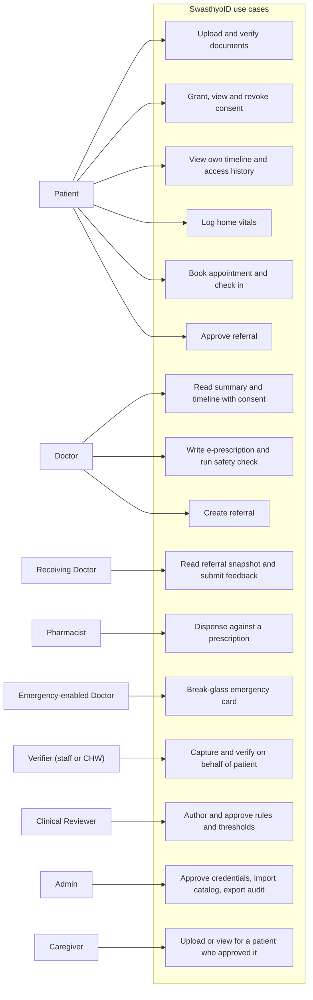

| Role | Can do | Cannot do |
|---|---|---|
| **Patient** (phone OTP) | Upload, verify own extractions, view own timeline and access history, grant/revoke consent, log vitals, reminders, triage, set emergency profile | See other patients |
| **Doctor** (BMDC verified, admin approved) | Request consent, read summary/timeline under consent, e-prescribe, safety check, ack/override alerts, create referrals, run visits | Read without consent, edit verified events |
| **Receiving Doctor** | Read the referral snapshot only, submit feedback | See beyond the snapshot, live timeline |
| **Emergency-enabled Doctor** | Break-glass access to the minimal emergency card | Full timeline, documents, search |
| **Pharmacist** (licence verified) | Prescription-bound access, safety check, record dispensing, ack/override alerts | See the timeline, edit prescriptions |
| **Verifier** (staff/CHW) | Capture and verify for a present, consenting patient, check patients in | Read timelines, grant consent for a patient |
| **Clinical Reviewer** | Draft/approve rules, thresholds, red-flag lists, emergency messages, review break-glass sessions | Access patient data |
| **Admin** | Users, credential approval, catalog import, audit export | Read clinical content |
| **Caregiver** (own person account, phone OTP) | With a patient-approved `CAREGIVER` authorization, only the scopes granted: `upload_documents`, `view_documents`, `view_timeline`; request an authorization | Verify extractions, grant or revoke consent for the patient, read the patient's access history, approve their own request |

**Authorization model:** RBAC (which endpoints a role may call) plus ABAC (per request: actor, patient, purpose, data categories, resource binding such as appointment, referral or prescription ID, consent state, appointment status, time window, device).

**Health ID:** `SID-` + 10 digits with a check digit. Random, unique, not derived from a phone number or national ID.

**Doctor and pharmacist verification:** register with BMDC number or pharmacy licence number plus a credential document, admin reviews (clinical reviewer may double-check), status `pending → verified → suspended`. An unverified doctor or pharmacist cannot create referrals or prescriptions, request consent, or dispense. Suspension revokes all active grants immediately.

---

## 3. System architecture

### 3.1 System context

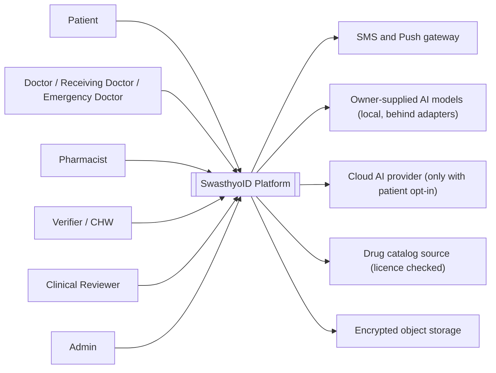

### 3.2 Layered architecture

```mermaid
flowchart TB
    subgraph Clients["Clients"]
        PA["Patient App"]
        DW["Doctor Web"]
        PW["Pharmacist Web"]
        VA["Verifier App"]
        AC["Admin and Reviewer Console"]
    end

    subgraph Gateway["API Gateway layer - /api/v1"]
        AUTH["JWT authentication"] --> RBAC["RBAC role check"]
        RBAC --> AZ["C1 authorize (ABAC)"]
        AZ --> AUD["C2 audit write"]
    end

    subgraph Core["Shared core services"]
        C1["C1 Consent and Authorization"]
        C2["C2 Audit"]
        C3["C3 Notification"]
        C4["C4 Event and Provenance"]
    end

    subgraph Modules["Feature modules"]
        M1["M1 Identity"]
        M2["M2 Capture and OCR"]
        M3["M3 Verification"]
        M4["M4 Timeline"]
        M5["M5 Summary and Search"]
        M6["M6 Safety Rules"]
        M7["M7 Triage"]
        M8["M8 Reminders"]
        M9["M9 Referral Passport"]
        M10["M10 Emergency Access"]
        M11["M11 e-Prescription and Pharmacist"]
        M12["M12 Appointment Consent"]
        M13["M13 Home Vitals"]
    end

    subgraph Infra["Infrastructure"]
        DB[("PostgreSQL")]
        VEC[("pgvector and pg_trgm in PostgreSQL (from P3)")]
        OBJ[("Object storage")]
        Q[("Worker processes (how they run: M2 plan decision D9)")]
        AIF["AI provider interfaces (OCR, VLM, LLM, embedding, classifier) - no bundled models"]
    end

    Clients --> AUTH
    AUD --> Modules
    Modules --> Core
    Modules --> Infra
    Core --> Infra
```

**Architecture rules:** (1) every module uses C1 for access decisions; (2) every module writes to the timeline through C4 with provenance; (3) clients never touch the database; (4) a modular monolith until the pilot shows a reason to split; (5) AI models are reached only through the provider interfaces in section 8, never imported directly by a module.

### 3.3 Module dependency map

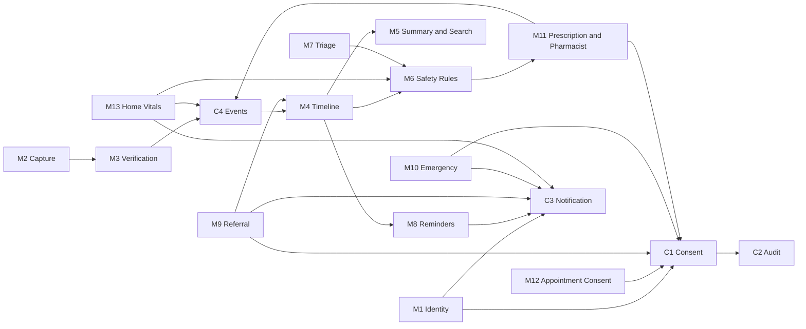

### 3.4 Deployment view (prototype)

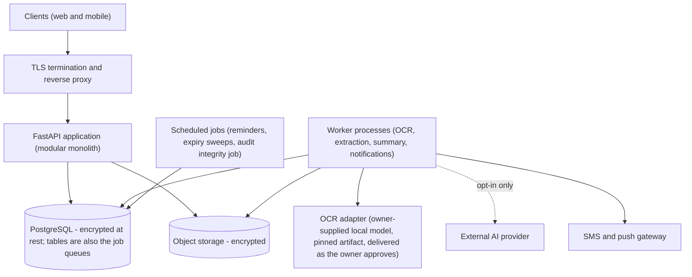

### 3.5 Technology stack
FastAPI · one PostgreSQL (pg_trgm and pgvector added when P3 needs them; decided 2026-11-11, `docs/DECISIONS.md` Q2) · worker processes using database tables as queues (Celery and Redis optional later; M2 plan decision D9) · encrypted object storage · **AI provider interfaces with owner-supplied models** (OCR adapter for the local OCR model; optional vision-language, LLM, embedding and classifier adapters; the platform bundles no model on its own initiative, see section 8).

---

## 4. Shared core services

### 4.1 C1 — Consent and Authorization

One service decides every non-patient access. It answers: who is asking, for which patient, for what purpose, which data categories, what did the patient allow, is it still active, has it expired or been revoked.

**Consent purposes**

| Purpose | Grantee | Bound to | Data scope | Activates when | Ends when |
|---|---|---|---|---|---|
| `TIMELINE` | Doctor | Doctor + patient | Categories patient picks (timeline, documents, safety) | Doctor submits patient OTP or QR | Expiry or revoke |
| `APPOINTMENT` | Doctor | Appointment ID | Categories patient approved at booking | Patient **checked in** | Visit completed, cancelled, grace period over, or max window |
| `REFERRAL` | Receiving doctor | Referral ID | Selected events in a frozen snapshot, not the live timeline | Patient approves | Token expiry, revoke, closed |
| `DISPENSING` | Pharmacist | Prescription ID | That prescription plus active medications and allergies for safety check | Patient shows QR or OTP | Dispense complete or expiry |
| `EMERGENCY` | Emergency-enabled doctor | Emergency session | Emergency card fields only | Break-glass with reason | Short time-boxed session |
| `CLOUD_AI` | System | Patient | Document image to external AI | Patient opts in | Patient opts out |
| `CAREGIVER` | Caregiver (person account) | Patient + caregiver | Scopes granted separately: `upload_documents`, `view_documents`, `view_timeline`. Never verification | Patient approves (in the app, or by reading out a code sent to the patient's own phone) | Expiry, revoke, or replacement by a newly approved request |

**Caregiver rules** (`docs/DECISIONS.md`, "Caregiver access"): scopes never change on an existing authorization; more scopes or time is a new request that, once approved, replaces the old one in one transaction. One active and one pending authorization per patient-caregiver pair. Provisional values, to be confirmed: default 30 days, maximum 90 days (no permanent authorization), an unapproved request closes after 24 hours.

**Unified consent record:** `consent_id, patient_id, grantee_id, grantee_role, purpose, resource_binding {type,id}, allowed_categories[], method (OTP/QR/in-app), status, activated_at, expires_at, max_window_ends_at, revoked_at, revoked_by, consent_version, policy_version`.

**Consent state machine**

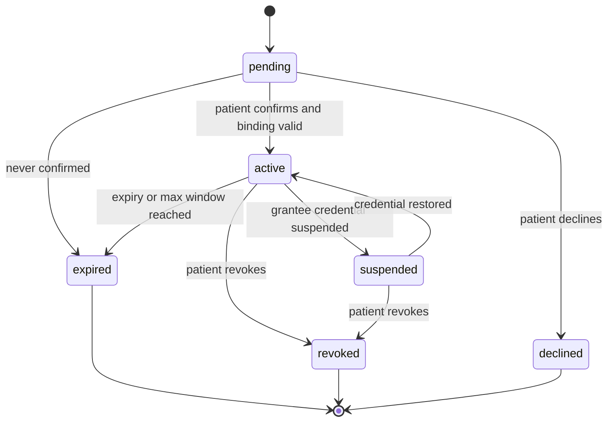

`declined` (the patient said no) is distinct from `expired` (nobody answered). A `CAREGIVER` authorization replaced by a newly approved one ends as `revoked`.

**Authorization decision flow**

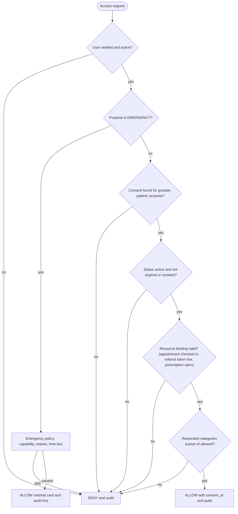

```python
def authorize_access(req, user, patient, consent):
    if not (user.is_verified and user.is_active):          return deny("user_not_verified")
    if req.purpose == "EMERGENCY":                         return emergency_policy(req, user, patient)
    if consent is None:                                    return deny("consent_required")
    if consent.patient_id != patient.id:                   return deny("patient_mismatch")
    if consent.grantee_id != user.id:                      return deny("grantee_mismatch")
    if consent.purpose != req.purpose:                     return deny("purpose_mismatch")
    if consent.status != "active":                         return deny("not_active")
    if now() > consent.expires_at or now() > consent.max_window_ends_at:
                                                           return deny("expired")
    if not binding_valid(consent, req.resource):           return deny("binding_invalid")
    if not req.data_categories.issubset(consent.allowed_categories):
                                                           return deny("category_not_allowed")
    return allow(consent_id=consent.id)                    # caller must write the C2 audit entry
```

Every deny is audited too. If C1 is down, all non-patient access stops (fail closed). Revocation applies from the next request.

### 4.2 C2 — Audit

| Requirement | Implementation |
|---|---|
| Append-only | No update or delete path in the application. The database user has insert permission only |
| Tamper-evident | Each entry stores `prev_hash` and `entry_hash`. A daily job verifies the chain. The chain head is anchored elsewhere |
| Server timestamps | Client time is never trusted |
| Actor context | actor_id, role, device_id, IP, user agent |
| Failed attempts | Every deny and auth failure is logged |
| Fail closed | If the audit write fails, the request fails. Emergency uses a write-ahead local buffer and reconciles later |
| Patient transparency | Patient sees who read what and when |

**Logged:** logins, consent create/activate/revoke/expire, every patient-data read, alert ack/override, rule approval, referral status changes (by whom), dispensing, break-glass, credential approval, threshold changes, notification failures.

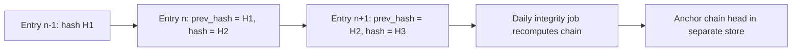

### 4.3 C3 — Notification

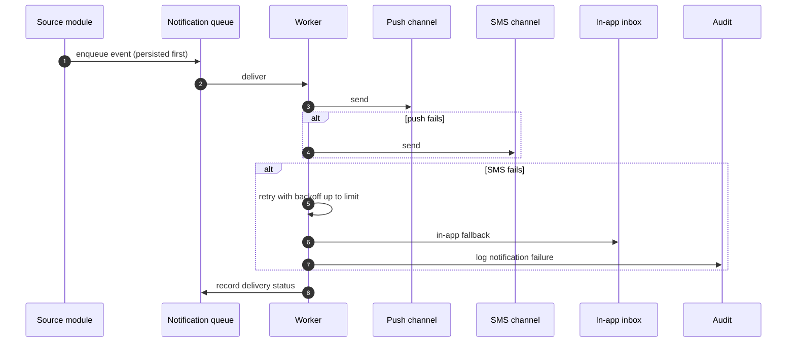

Bangla by default, quiet hours in Asia/Dhaka (emergency-access alerts and critical safety messages ignore quiet hours). Templates for vitals and emergency are clinician-approved. Consent and emergency-access security notices cannot be switched off. The health event or audit record exists regardless of delivery.

### 4.4 C4 — Event and Provenance

**Mandatory fields on every event:** `event_id, event_type, patient_id, date + date_precision, actor_id, actor_role, source_type, source_document_id, recorded_at, verified_by, verified_at, verification_status, related_record_id, version, supersedes, payload`.

**Event types:** visit, diagnosis, medication, lab_result, allergy, follow_up, prescription, dispense, vital_reading, referral, referral_feedback.

| verification_status | Meaning | Example |
|---|---|---|
| `document_verified` | A human verified data extracted from paper | Verified prescription |
| `clinician_authored` | Authenticated doctor created it | e-Prescription |
| `pharmacist_recorded` | Authenticated pharmacist recorded it | Dispense event |
| `doctor_submitted` | Authenticated doctor submitted it (not clinically verified) | Referral feedback |
| `patient_reported` | Patient entered it | Home BP |
| `pending` | Awaiting verification | Not on the timeline |

**Rules:** events are never overwritten, a change is a new event linked by `supersedes`. Prescribed, dispensed and patient-taking are three separate events so the timeline shows which is current. Duplicates merge on `(type, date, generic, dose)`. Patient-reported events are never used as verified facts in safety rules and appear in their own summary section.

---

## 5. Modules

### M1 — Identity, Health ID and Consent Center
- Patient registration by phone OTP, profile (name, date of birth, sex, language), Health ID issue.
- Doctor, pharmacist and verifier onboarding with credential verification (section 2).
- Short-lived JWT access and refresh tokens, device binding.
- **Consent Center:** one list of every consent (who, purpose, categories, expiry), one-tap revoke, access history from the audit log, separate cloud-AI opt-in toggle, emergency profile settings.
- Doctor requests consent by Health ID, the patient confirms by OTP or QR.
- Edge cases: phone number change (re-verify, log out old devices), shared phone (app lock), minors and guardians (open question).
- **Done when:** a doctor without consent gets 403 and an audit entry exists; revoke blocks the next request; an unverified doctor cannot request consent.

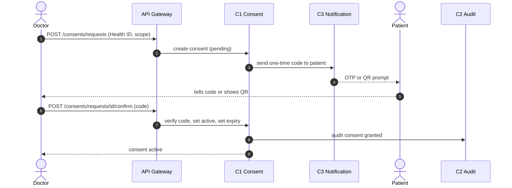

### M2 — Capture and Extraction
- Accept one or more JPEG/PNG images per document and a `doc_type` (prescription, lab report, discharge summary, other).
- Store the original encrypted. Document status `uploaded`.
- Background job: pre-process (rotate, deskew, denoise, contrast), run the **configured OCR adapter** (section 8), low-confidence regions to a **configured vision-language adapter only if the patient opted in**, otherwise left for manual entry.
- The OCR adapter is the only way M2 reaches an OCR model. Its output is checked by a versioned validator and carries the model identity (section 8.2). What exactly it returns (granularity, confidence, position) is **open until the owner's model specification is supplied**; until then an infrastructure-test interface (version 0, `docs/DECISIONS.md` D17) is used by test adapters only. Version 0 is not an OCR contract and not a production requirement. The model itself is selected, trained and supplied by the project owner; M2 contains no model-specific code outside the adapter.
- **No real patient data is used in OCR execution** until the extraction-data encryption and privacy controls (M2 plan step 2) are implemented and approved by the owner.
- **No OCR adapter available** (none configured, or it fails its integrity or load check before any document is taken): nothing is claimed, no attempt is counted, the document stays `uploaded` (due), and it is never marked `extraction_failed` for that reason. The patient can send it straight to manual entry (decided 2026-11-12, `docs/DECISIONS.md`, Option A). *Whether a load failure counts as "unavailable" is an open sub-decision there.*
- **The adapter fails during an attempt:** that attempt fails and counts toward the retry limit. No other engine is tried.
- **Manual entry** can start from `uploaded`, from `extracting` while no worker holds a live claim, or from `extraction_failed`. It moves the document to `needs_review` with every field empty, is audited, and never races a running extraction (only one of them can store).
- Parse to a typed schema with per-field confidence, validate types and dates, normalise Bangla and English numerals, fuzzy-match drug names to the catalog.
- Blur and glare detection asks for a retake.
- Retries with backoff, idempotent by `(document_id, version)`.
- **Done when:** every document claimed while an adapter is available ends in `needs_review` or `extraction_failed` within a bounded time from its first claim; with no adapter available, documents stay due, are never marked failed, and can always go to manual entry; no extraction ever writes directly to events; the infrastructure conformance tests pass; no fallback engine is ever invoked. These are shown with test adapters (**infrastructure ready**). **Production readiness** additionally needs the owner's model, integrated after explicit approval, passing the infrastructure tests and the model-output conformance tests written for its approved contract (section 11).

### M3 — Human Verification
- Image beside extracted fields. Fields under the confidence threshold (start 0.85, configurable) are highlighted. Confirm stays disabled until every field is edited or confirmed.
- Drug names resolve to generic ingredients through the catalog with suggestions.
- **Confirm:** one database transaction writes immutable events (`document_verified`), sets the document `verified`, logs each correction as before/after, and queues indexing and reminder proposals. **Reject:** status `rejected`.
- The verifier is the patient, or staff/CHW assisting a present, consenting patient.
- **Done when:** no event exists for an unverified document; per-field correction rate is recorded; repeating confirm creates no duplicates.

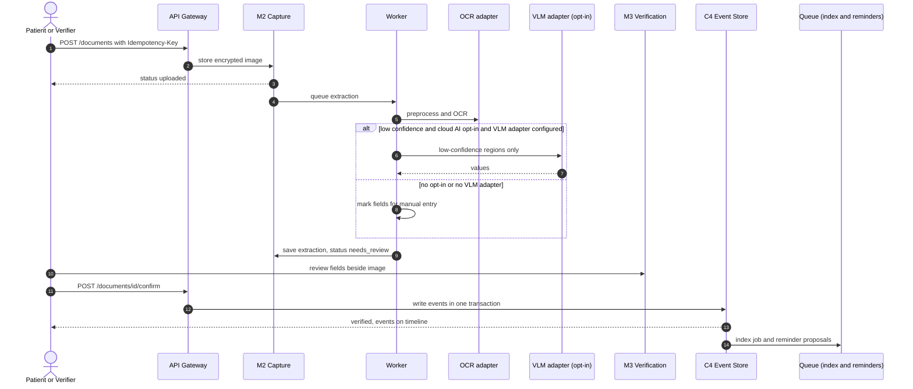

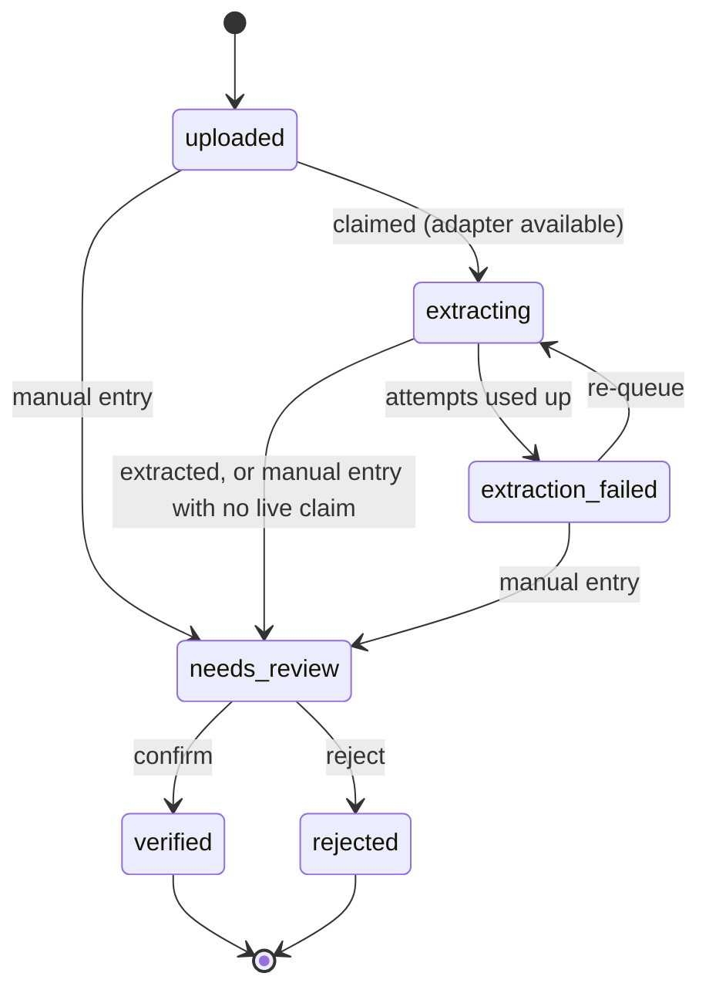

### M4 — Event Store and Timeline
- Events grouped by year and month, filters by type and date range, provenance badge on every event, link to the source image.
- Patient-reported events use a distinct label and filter. Correction history stays visible.
- Doctor view is restricted to the categories in the active consent.
- **Done when:** order is stable, history survives corrections, every event links to its source.

### M5 — Doctor Summary and Search
- **Sections:** active medications, allergies, documented diagnoses, recent labs with trend, recent visits, pending follow-ups, recent referral feedback, and patient-reported vitals (separate, labelled "reported by patient, not verified").
- If an **LLM adapter** is configured, it writes the text from structured events only. Every sentence carries citations. A code validator checks each drug, number and date against the cited events. On failure, provider error, or when no LLM adapter is configured, return a deterministic template summary (`mode: template`). Vitals appear only as template lines (values and dates), never interpreted.
- Cache by `(patient_id, events_version)`.
- **Search:** keyword always; semantic (Bangla and English) when an **embedding adapter** is configured. `patient_id` and consent categories are hard filters in every keyword and vector query in PostgreSQL. Results are event IDs with source links, not generated answers.
- **Done when:** a summary never contains an entity absent from cited events; a search never returns another patient's record or a category outside the consent.

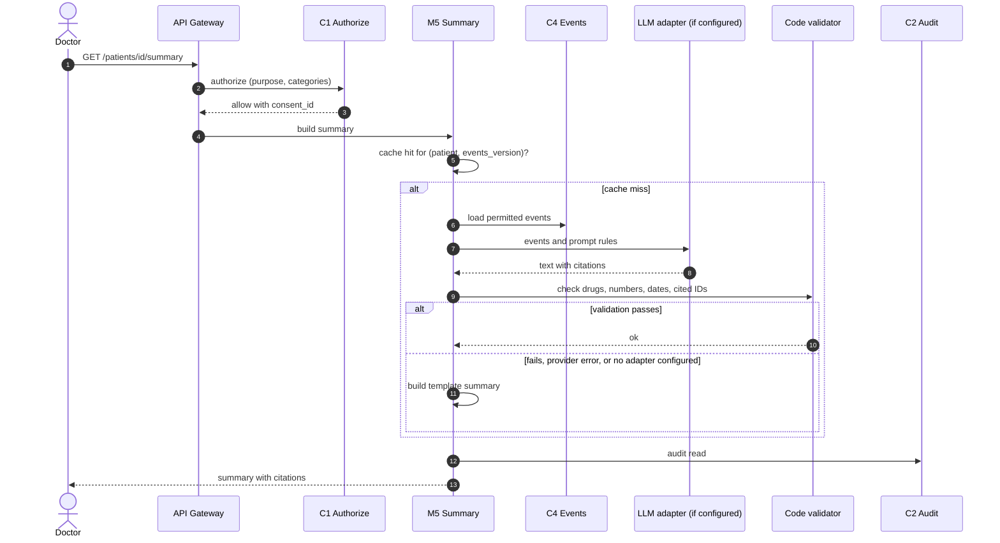

### M6 — Prescription Safety Rule Engine
- **Input:** drugs in a new or just-verified prescription plus the patient's active medications, allergies and documented diagnoses (verified, authored or pharmacist-recorded events only, never patient-reported).
- Normalise each brand to generic ingredients, then run the checks:

| Check | Rule source | Output |
|---|---|---|
| Drug-drug interaction | Pair table: contraindicated, major, moderate, minor | Alert with rule ID and explanation |
| Allergy | Allergy events, including ingredient class | Alert |
| Duplicate therapy | Same ingredient or class already active | Alert |
| Drug-disease | Drug and documented condition table | Alert |
| Recent same-class course | Configurable look-back | Review flag |
| Unrecognised drug | Not in catalog | `unrecognised` flag, never silently passed |

- Only rules with status `approved` run. Every change creates a new rule version.
- Each alert shows rule ID, severity, Bangla and English explanation, and links to the triggering events. The doctor or pharmacist must **acknowledge** or **override with a reason**, both audited.
- One rule registry holds all rule types: `ddi, allergy, duplicate, drug_disease, class_lookback, vital_threshold, red_flag, emergency_message`, with one approval workflow.
- Rule load error blocks the check with an explicit error.
- M6 uses no AI model. Rules are deterministic.
- **Done when:** the same input always gives the same output and the clinician-written golden cases all pass.

### M7 — First-Aid and Department Guide (Triage)
- **Stage 1, red flags:** the clinician-approved list checks the first message and every answer. A match shows the emergency card (999) and stops the questions.
- **Stage 2, questions:** limited follow-ups chosen from a symptom-to-department guide table.
- **Stage 3, suggestion:** department with a short reason and a notice that this is guidance, not diagnosis. A **classifier adapter**, if configured, may add a second opinion. If it disagrees with a red-flag rule, the rule wins.
- First-aid cards are static and clinician-reviewed. An LLM adapter, if configured, may rephrase questions but never decides red flags or departments. With no adapter configured, the original guide-table wording is shown.
- If the rule engine is unavailable: show the emergency card and general advice to seek care.
- No free text kept after the session unless the patient saves it.
- **Done when:** every red-flag test case routes to the emergency card and no output states a diagnosis.

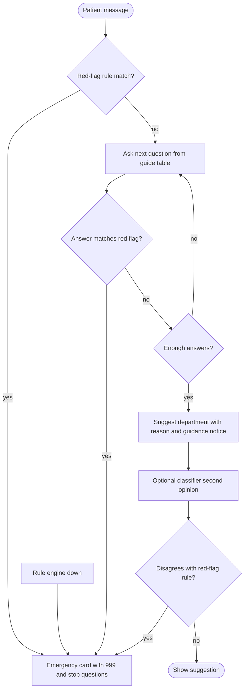

### M8 — Reminders and Follow-up
- Proposals come only from verified events: medicine times from the written frequency and duration, follow-up visits, advised tests, refill nudges after a dispense event.
- **Nothing activates until the patient confirms.** Delivery by push and SMS in Bangla with quiet hours (Asia/Dhaka).
- Log taken, skipped, snoozed. If an advised test has no result in its window, send a nudge.
- Reminders repeat what the prescription says and never suggest a dose. A patient may create their own "measure BP" reminder, labelled as self-created.

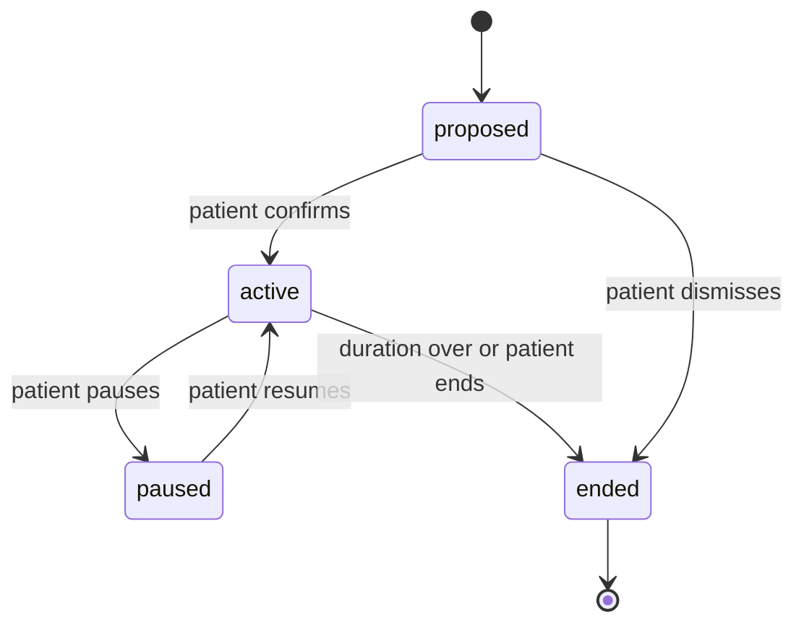

### M9 — Referral Passport
A verified, patient-controlled digital referral workflow, not a plain link.

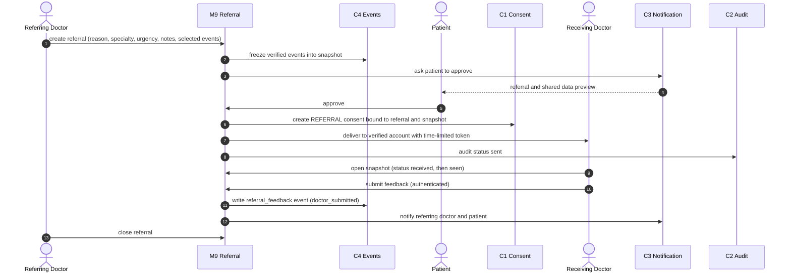

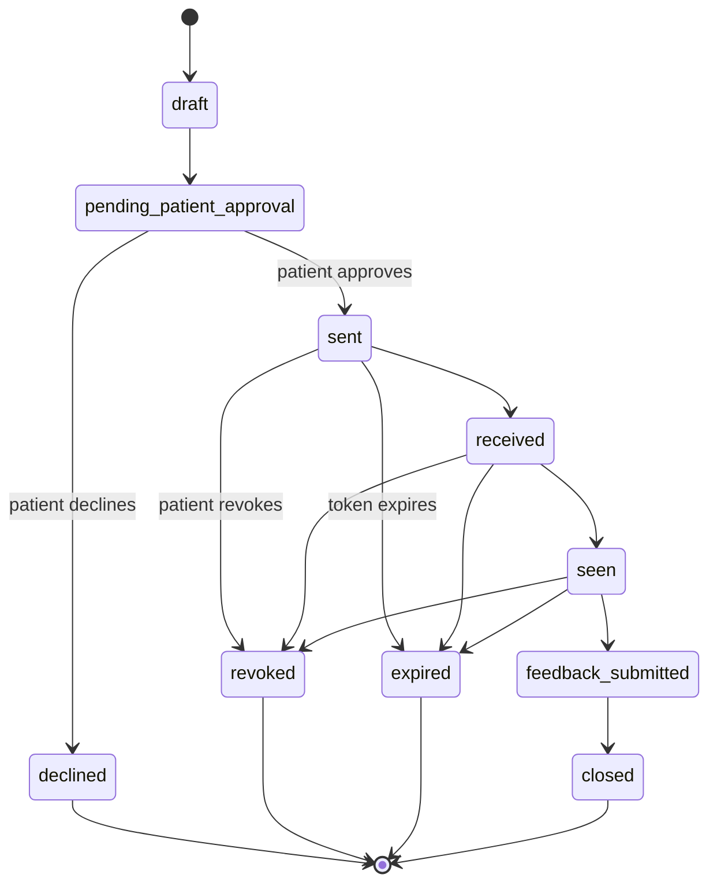

| Component | Solution |
|---|---|
| Verification | Verified referring and receiving doctors |
| Referral ID | UUID |
| Snapshot | Timestamped, source-attributed, immutable |
| Consent | Referral-specific record, purpose `REFERRAL` |
| Access | RBAC + referral-specific ABAC bound to snapshot ID |
| Expiry | Configurable, plus patient revocation |
| Feedback | Authenticated doctor submission, author and timestamp verifiable. **Not automatically clinically verified** |
| Audit | Append-only, records who changed each status |
| Duplicates | Idempotency key |
| Offline (after pilot) | Encrypted PDF snapshot with QR verification, only if security policy allows |

**Urgent referral:** if the patient cannot approve in time, the referring doctor records the urgency reason, only the minimum categories are shared, the patient and emergency contact are notified immediately, the patient can revoke, and the case enters post-hoc review. Behind a feature flag until clinical and legal sign-off.

**Rules:** the receiving doctor sees only the snapshot. The snapshot date is always shown. New data needs a new consent request.

**Acceptance:** unverified doctors cannot refer; no clinical data is shared without approval (except the urgent workflow); only approved data is visible; expired or revoked access shows nothing; feedback author and timestamp are verifiable; every status change is audited; duplicate requests create one referral.

### M10 — Emergency Access (feature-flagged)
Minimal emergency card for an unconscious or incapable patient. Enabled only after clinical reviewer and legal approval.

- **Emergency profile:** the patient chooses fields (blood group if verified, allergies, active medications, long-term documented conditions, emergency contacts), built from verified events. Off until the patient turns it on.
- **Break-glass:** only emergency-enabled doctors. Reason and facility are mandatory. Session is time-boxed (default 2 hours, configurable) and shows card fields only.
- The audit entry is written first. The patient and emergency contact are notified immediately. Every session lands in post-hoc review. An unjustified access suspends the doctor's emergency capability.

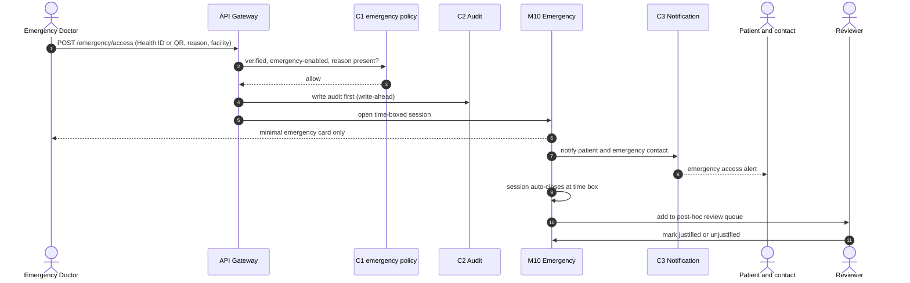

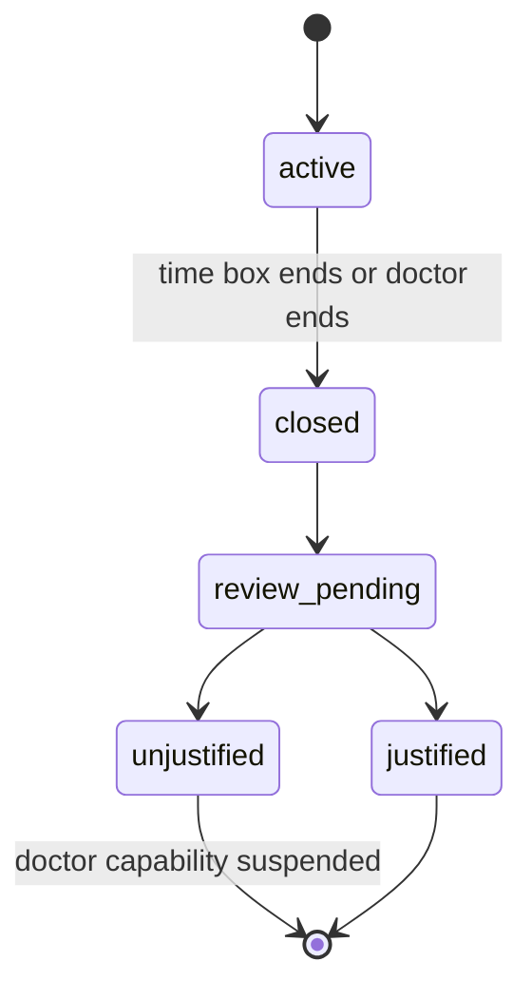

**Done when:** no break-glass access without a reason, every session notifies the patient, nothing beyond the card ever returns, all sessions reach review.

### M11 — e-Prescription and Pharmacist Dispensing
- **Doctor:** adds drugs from the catalog, M6 runs **before signing**, alerts acknowledged or overridden with reason, signing creates a `prescription` event (`clinician_authored`).
- **Pharmacist:** the patient presents a prescription QR or OTP (`DISPENSING` consent, bound to the prescription). The pharmacist sees only that prescription plus the active medications and allergies needed for the safety check. After the check, dispensing is recorded with items, quantity, substitution flag and date, creating a `dispense` event (`pharmacist_recorded`). Partial dispense and refills are separate events. The pharmacist cannot edit the prescription and can only query the doctor.
- Consent ends when dispensing completes. Prescribed, dispensed and patient-taking stay separate events.

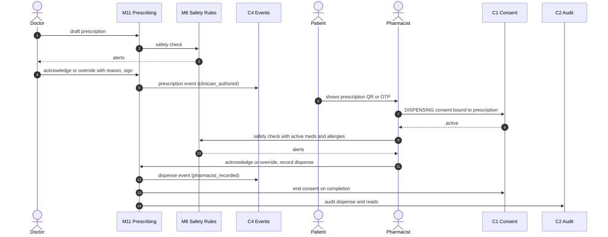

```mermaid
stateDiagram-v2
    [*] --> active : doctor signs
    active --> partially_dispensed
    partially_dispensed --> partially_dispensed : another partial
    partially_dispensed --> dispensed
    active --> dispensed
    active --> expired
    active --> cancelled
    partially_dispensed --> expired
    dispensed --> [*]
    expired --> [*]
    cancelled --> [*]
```

**Done when:** unverified pharmacists cannot dispense; dispensing needs a safety check (overrides carry a reason); consent ends at completion; the dispense event carries provenance.

### M12 — Appointment-Bound Explicit Consent
- Booking: patient picks a doctor and time, sees a **consent preview** of which categories the doctor could see, then gives a separate explicit approval. Booking works without consent, only clinical access is withheld.
- Access is tied to appointment ID + doctor ID + patient ID + categories.
- Clock time alone never decides expiry. **Appointment status plus a maximum access window** does:

| Appointment status | Access |
|---|---|
| `scheduled` | Pending (no access) |
| `checked_in` | Active, until the max window ends |
| `visit_completed` | Revoked |
| `no_show` | Expires after the configured grace period |
| `cancelled` | Revoked immediately |
| `rescheduled` | Old consent void, new consent required |

- Check-in is done by the patient (app or QR) or by a clinic verifier with the patient present. Multiple doctors are authorized individually. A follow-up appointment needs a new consent.

```mermaid
sequenceDiagram
    autonumber
    actor Pat as Patient
    participant M12 as M12 Appointments
    participant C1 as C1 Consent
    actor Doc as Doctor
    participant M5 as M5 Summary
    participant C2 as C2 Audit

    Pat->>M12: book appointment (doctor, time)
    M12-->>Pat: consent preview of categories
    Pat->>M12: explicit approval (separate confirmation)
    M12->>C1: create APPOINTMENT consent (pending)
    Pat->>M12: check in (app, QR, or verifier)
    M12->>C1: activate with max window
    Doc->>M5: open pre-visit summary
    M5->>C1: authorize
    C1-->>M5: allow
    M5->>C2: audit read
    Doc->>M12: complete visit
    M12->>C1: revoke consent
    M12-->>Pat: notify access ended
```

```mermaid
stateDiagram-v2
    [*] --> scheduled
    scheduled --> checked_in : check-in
    checked_in --> visit_completed : doctor completes
    scheduled --> no_show : grace period over
    scheduled --> cancelled
    checked_in --> cancelled
    scheduled --> rescheduled : new appointment and new consent
    visit_completed --> [*]
    no_show --> [*]
    cancelled --> [*]
    rescheduled --> [*]
```

**Done when:** no consent means no clinical access; the approved categories are visible to the patient; cancel and complete revoke access; a reschedule never inherits the old consent; every access is audited.

### M13 — Home Vitals (patient-reported BP and glucose)
MVP is **manual entry only**, no wearables.

- Entry captures value, unit (standardized dropdown), date and time, measurement context (glucose: fasting, post-meal, random; BP: home, resting), and source.
- Validation: unit, data type, plausibility. Suspicious values need confirmation.
- Creates a `vital_reading` event with `verification_status = patient_reported`. It can never be shown as device-verified.
- Rules: threshold rules live in the M6 registry. The default rules are drafted and approved by a clinical reviewer. A per-patient override can be set only by the treating doctor under active consent. Patients and verifiers cannot change thresholds. Every change is versioned and audited.
- Alerts are non-diagnostic. A critical-range reading (for example 180/120) must show a **clinically reviewed escalation message** telling the patient to seek appropriate urgent care, with a link to the emergency card. A normal reading never says "you are safe", only that it is within the configured range and to tell a doctor about symptoms.
- Correction: the original is preserved and a correction event is added. Duplicates are caught by event ID + timestamp.

```mermaid
sequenceDiagram
    autonumber
    actor Pat as Patient
    participant M13 as M13 Vitals
    participant VAL as Validator
    participant C4 as C4 Events
    participant M6 as M6 Threshold rules
    participant C3 as C3 Notification

    Pat->>M13: enter reading (value, unit, context, time)
    M13->>VAL: unit, type, plausibility
    alt suspicious value
        VAL-->>Pat: please confirm this reading
        Pat->>M13: confirm
    end
    M13->>C4: vital_reading event (patient_reported)
    M13->>M6: evaluate approved thresholds
    M6-->>M13: normal, flagged, or review required
    alt critical range
        M13->>C3: reviewed escalation message (ignores quiet hours)
    else flagged
        M13->>C3: non-diagnostic alert
    end
    M13-->>Pat: saved and labelled patient-reported
```

**Acceptance:** manual readings are never device-verified; unit validation is mandatory; glucose context is saved; only clinicians change thresholds; abnormal readings are flagged; alerts are never diagnoses; correcting a reading never loses the original.

---

## 6. Data model

### 6.1 Overview ERD (relationships only)

```mermaid
erDiagram
    CLINICS ||--o{ USERS : employs
    USERS ||--o{ CREDENTIALS : holds
    PATIENTS ||--o{ CONSENTS : grants
    USERS ||--o{ CONSENTS : "is grantee"
    CONSENTS ||--o{ CONSENT_EVENTS : logs
    PATIENTS ||--o| EMERGENCY_PROFILES : configures
    PATIENTS ||--o{ DOCUMENTS : uploads
    DOCUMENTS ||--o{ EXTRACTIONS : produces
    DOCUMENTS ||--o{ DOCUMENT_CORRECTIONS : records
    DOCUMENTS ||--o{ EVENTS : "is source of"
    PATIENTS ||--o{ EVENTS : owns
    EVENTS ||--o| EVENTS : supersedes
    PATIENTS ||--o{ SUMMARIES : caches
    PATIENTS ||--o{ APPOINTMENTS : books
    USERS ||--o{ APPOINTMENTS : attends
    APPOINTMENTS ||--o| CONSENTS : "scopes"
    PATIENTS ||--o{ PRESCRIPTIONS : receives
    USERS ||--o{ PRESCRIPTIONS : signs
    PRESCRIPTIONS ||--o{ PRESCRIPTION_ITEMS : contains
    PRESCRIPTION_ITEMS }o--|| DRUG_CATALOG : "maps to"
    PRESCRIPTIONS ||--o{ DISPENSE_RECORDS : "is dispensed by"
    USERS ||--o{ DISPENSE_RECORDS : records
    PRESCRIPTIONS ||--o{ SAFETY_ALERTS : triggers
    RULES ||--o{ SAFETY_ALERTS : "raised by"
    PATIENTS ||--o{ REFERRALS : "is subject of"
    REFERRALS ||--|| REFERRAL_SNAPSHOTS : freezes
    REFERRALS ||--o{ REFERRAL_EVENTS : tracks
    REFERRALS ||--o{ REFERRAL_FEEDBACK : receives
    PATIENTS ||--o{ VITAL_MEASUREMENTS : reports
    VITAL_MEASUREMENTS ||--o{ VITAL_ALERTS : raises
    VITAL_THRESHOLD_RULES ||--o{ VITAL_ALERTS : evaluates
    PATIENTS ||--o{ EMERGENCY_SESSIONS : "accessed in"
    USERS ||--o{ EMERGENCY_SESSIONS : opens
    PATIENTS ||--o{ REMINDERS : confirms
    REMINDERS ||--o{ ADHERENCE_LOGS : logs
    PATIENTS ||--o{ TRIAGE_SESSIONS : runs
    PATIENTS ||--o{ NOTIFICATIONS : receives
    NOTIFICATIONS ||--o{ NOTIFICATION_DELIVERIES : attempts
    USERS ||--o{ AUDIT_LOGS : performs
```

### 6.2 ERD A — Identity and consent

```mermaid
erDiagram
    CLINICS ||--o{ USERS : employs
    USERS ||--o{ CREDENTIALS : holds
    PATIENTS ||--o{ CONSENTS : grants
    USERS ||--o{ CONSENTS : "is grantee"
    CONSENTS ||--o{ CONSENT_EVENTS : logs
    PATIENTS ||--o| EMERGENCY_PROFILES : configures

    CLINICS {
        uuid id PK
        string name
        string district
    }
    PATIENTS {
        uuid id PK
        string health_id UK
        string phone_hash UK
        string phone_enc
        string name_enc
        date dob
        string sex
        string language
        boolean cloud_ai_opt_in
        datetime created_at
    }
    USERS {
        uuid id PK
        string role
        string name
        string status
        uuid clinic_id FK
        boolean emergency_enabled
    }
    CREDENTIALS {
        uuid id PK
        uuid user_id FK
        string type
        string number UK
        string doc_key
        string status
        uuid reviewed_by FK
    }
    CONSENTS {
        uuid id PK
        uuid patient_id FK
        uuid grantee_id FK
        string purpose
        string resource_type
        uuid resource_id
        string[] allowed_categories
        string method
        string status
        datetime activated_at
        datetime expires_at
        datetime max_window_ends_at
        datetime revoked_at
        interval requested_ttl
        int consent_version
    }
    CONSENT_EVENTS {
        uuid id PK
        uuid consent_id FK
        string action
        uuid actor_id
        datetime at
    }
    EMERGENCY_PROFILES {
        uuid id PK
        uuid patient_id FK
        boolean enabled
        string[] fields
        json contacts
    }
```

`CONSENTS.grantee_id` may reference a person account (a caregiver) as well as a user. `requested_ttl` is the duration a `CAREGIVER` request asked for; the expiry is set from it on approval.

### 6.3 ERD B — Documents, events and timeline

```mermaid
erDiagram
    PATIENTS ||--o{ DOCUMENTS : uploads
    DOCUMENTS ||--|{ DOCUMENT_IMAGES : "stores originals"
    DOCUMENTS ||--o{ EXTRACTIONS : produces
    DOCUMENTS ||--o{ DOCUMENT_CORRECTIONS : records
    DOCUMENTS ||--o{ EVENTS : "is source of"
    PATIENTS ||--o{ EVENTS : owns
    USERS ||--o{ EVENTS : "acts on"
    EVENTS ||--o| EVENTS : supersedes
    PATIENTS ||--o{ SUMMARIES : caches

    DOCUMENTS {
        uuid id PK
        uuid patient_id FK
        string doc_type
        string status
        uuid uploaded_by FK
        uuid verified_by FK
        int extraction_attempts
        datetime next_extraction_at
        string extraction_error
        uuid extraction_claim
    }
    DOCUMENT_IMAGES {
        uuid document_id FK
        int n
        string storage_key UK
        string content_type
        int size_bytes
        string sha256
    }
    EXTRACTIONS {
        uuid id PK
        uuid document_id FK
        string engine
        string engine_id
        string model_version
        string model_checksum
        int adapter_interface_version
        json fields
        string raw_text
        int version
    }
    DOCUMENT_CORRECTIONS {
        uuid id PK
        uuid document_id FK
        string field
        string before_value
        string after_value
        uuid corrected_by FK
    }
    EVENTS {
        uuid id PK
        uuid patient_id FK
        string event_type
        date event_date
        string date_precision
        uuid actor_id FK
        string actor_role
        string source_type
        uuid source_document_id FK
        datetime recorded_at
        uuid verified_by FK
        datetime verified_at
        string verification_status
        uuid related_record_id
        int version
        uuid supersedes FK
        json payload
    }
    SUMMARIES {
        uuid id PK
        uuid patient_id FK
        int events_version
        string text
        json citations
        string mode
        string model_id
    }
```

`DOCUMENT_IMAGES` replaces the earlier `documents.image_keys`: an append-only row per original image with its SHA-256, checked on every read. The `extraction_*` columns on `DOCUMENTS` hold the extraction job state (attempt count, due time or lease end, error type only, claim token).

`EXTRACTIONS.engine` is the engine name recorded today (`manual` for manual entry); it stays, because the table is append-only. `engine_id`, `model_version`, `model_checksum` and `adapter_interface_version` identify the model that produced the extraction; they are planned for M2 step 4A (names provisional; not yet in the schema) and are empty for manual entries. How `model_checksum` is computed depends on the artifact-manifest format, which is open until the model artifact is known. `raw_text` and `fields` are stored in plain form today, a recorded privacy risk (M2 plan step 2). `SUMMARIES.model_id` is empty when `mode = template`.

### 6.4 ERD C — Clinical workflows

```mermaid
erDiagram
    PATIENTS ||--o{ APPOINTMENTS : books
    USERS ||--o{ APPOINTMENTS : attends
    PATIENTS ||--o{ PRESCRIPTIONS : receives
    USERS ||--o{ PRESCRIPTIONS : signs
    PRESCRIPTIONS ||--o{ PRESCRIPTION_ITEMS : contains
    PRESCRIPTION_ITEMS }o--|| DRUG_CATALOG : "maps to"
    PRESCRIPTIONS ||--o{ DISPENSE_RECORDS : "is dispensed by"
    USERS ||--o{ DISPENSE_RECORDS : records
    PRESCRIPTIONS ||--o{ SAFETY_ALERTS : triggers
    RULES ||--o{ SAFETY_ALERTS : "raised by"
    PATIENTS ||--o{ REFERRALS : "is subject of"
    REFERRALS ||--|| REFERRAL_SNAPSHOTS : freezes
    REFERRALS ||--o{ REFERRAL_EVENTS : tracks
    REFERRALS ||--o{ REFERRAL_FEEDBACK : receives
    PATIENTS ||--o{ VITAL_MEASUREMENTS : reports
    VITAL_MEASUREMENTS ||--o{ VITAL_ALERTS : raises
    VITAL_THRESHOLD_RULES ||--o{ VITAL_ALERTS : evaluates
    PATIENTS ||--o{ EMERGENCY_SESSIONS : "accessed in"
    USERS ||--o{ EMERGENCY_SESSIONS : opens
    PATIENTS ||--o{ REMINDERS : confirms
    REMINDERS ||--o{ ADHERENCE_LOGS : logs
    PATIENTS ||--o{ TRIAGE_SESSIONS : runs

    APPOINTMENTS {
        uuid id PK
        uuid patient_id FK
        uuid doctor_id FK
        datetime slot
        string status
        datetime checked_in_at
        datetime completed_at
        uuid consent_id FK
    }
    PRESCRIPTIONS {
        uuid id PK
        uuid patient_id FK
        uuid doctor_id FK
        string status
        datetime signed_at
        uuid event_id FK
    }
    PRESCRIPTION_ITEMS {
        uuid id PK
        uuid prescription_id FK
        uuid catalog_id FK
        string strength
        string frequency
        int duration_days
    }
    DISPENSE_RECORDS {
        uuid id PK
        uuid prescription_id FK
        uuid pharmacist_id FK
        json items
        boolean substituted
        datetime dispensed_at
        uuid event_id FK
    }
    SAFETY_ALERTS {
        uuid id PK
        uuid rule_id FK
        uuid prescription_id FK
        string severity
        uuid[] evidence_event_ids
        string ack_action
        string override_reason
        uuid ack_by FK
    }
    REFERRALS {
        uuid id PK
        uuid patient_id FK
        uuid from_doctor FK
        uuid to_doctor FK
        string reason
        string specialty
        string urgency
        string status
        datetime token_expires_at
        string idempotency_key UK
    }
    REFERRAL_SNAPSHOTS {
        uuid id PK
        uuid referral_id FK
        uuid[] event_refs
        json frozen_payload
        datetime created_at
    }
    REFERRAL_EVENTS {
        uuid id PK
        uuid referral_id FK
        string status_from
        string status_to
        uuid changed_by FK
        datetime at
    }
    REFERRAL_FEEDBACK {
        uuid id PK
        uuid referral_id FK
        uuid doctor_id FK
        string text
        datetime submitted_at
        uuid event_id FK
    }
    VITAL_MEASUREMENTS {
        uuid id PK
        uuid patient_id FK
        uuid event_id FK
        string vital_type
        string value
        string unit
        string context
        string source
        datetime recorded_at
    }
    VITAL_THRESHOLD_RULES {
        uuid id PK
        string vital_type
        uuid patient_id FK
        json thresholds
        int version
        uuid approved_by FK
    }
    VITAL_ALERTS {
        uuid id PK
        uuid measurement_id FK
        uuid rule_id FK
        string status
        datetime shown_at
    }
    EMERGENCY_SESSIONS {
        uuid id PK
        uuid doctor_id FK
        uuid patient_id FK
        string reason
        string facility
        datetime started_at
        datetime ended_at
        string review_status
    }
    REMINDERS {
        uuid id PK
        uuid patient_id FK
        uuid source_event_id FK
        json schedule
        string channel
        string status
        datetime confirmed_at
    }
    ADHERENCE_LOGS {
        uuid id PK
        uuid reminder_id FK
        datetime fired_at
        string response
    }
    TRIAGE_SESSIONS {
        uuid id PK
        uuid patient_id FK
        boolean red_flag
        string suggested_department
        datetime ended_at
    }
    DRUG_CATALOG {
        uuid id PK
        string brand
        string[] generics
        string strength
        string form
        string source
    }
    RULES {
        uuid id PK
        string rule_type
        json definition
        string severity
        string status
        uuid approved_by FK
        int version
    }
```

### 6.5 ERD D — Platform services

```mermaid
erDiagram
    USERS ||--o{ AUDIT_LOGS : performs
    PATIENTS ||--o{ AUDIT_LOGS : "is subject of"
    CONSENTS ||--o{ AUDIT_LOGS : "authorizes"
    PATIENTS ||--o{ NOTIFICATIONS : receives
    NOTIFICATIONS ||--o{ NOTIFICATION_DELIVERIES : attempts

    AUDIT_LOGS {
        uuid id PK
        datetime at
        uuid actor_id FK
        string actor_role
        string device_id
        string ip
        string action
        uuid patient_id FK
        string resource_type
        uuid resource_id
        uuid consent_id FK
        string purpose
        string result
        string reason
        string prev_hash
        string entry_hash
    }
    NOTIFICATIONS {
        uuid id PK
        uuid recipient_id FK
        string template_id
        json payload
        string status
    }
    NOTIFICATION_DELIVERIES {
        uuid id PK
        uuid notification_id FK
        string channel
        int attempt
        string status
        string error
        datetime at
    }
    IDEMPOTENCY_KEYS {
        uuid actor_id PK
        string endpoint PK
        string key PK
        string request_hash
        json response
        datetime expires_at
    }
```

`IDEMPOTENCY_KEYS` is keyed by caller, endpoint and key together, and stores a keyed hash of the request so a reused key with a different body is refused. Retention: 24 hours (configurable default, `docs/DECISIONS.md`).

### 6.6 Storage notes
- **PostgreSQL:** all tables above. All records carry `created_at`, `updated_at`, IDs are UUIDs except the Health ID. Key indexes: `consents (grantee_id, patient_id, purpose, status)`, `events (patient_id, event_date)` and `(patient_id, event_type)`, `documents (patient_id, status)`, `reminders (status, next_fire_at)`. `events`, `audit_logs`, `document_images` and `extractions` are append-only, enforced by database triggers. Each module's schema is applied idempotently at startup.
- **Vectors (from P3):** an `event_chunks` table with a pgvector column, `patient_id` and `event_id`. `patient_id` is indexed and is always a filter.
- **Object storage:** `patients/{patient_id}/documents/{document_id}/{n}.jpg`, encrypted at rest.
- **Model artifacts:** owner-supplied model files are pinned by checksum and enter a deployment only with the owner's explicit approval, by the method the owner sets (mounted read-only, or packaged into the build; M2 plan decision D4). They are not stored in patient storage and are never downloaded at run time.
- Phone and name are field-level encrypted. A phone hash is used for lookup.

---

## 7. API summary (`/api/v1`)

All endpoints need a bearer token except OTP request and verify. Errors use `{ "code": "consent_required", "message": "...", "details": {} }`. Every write accepts an `Idempotency-Key` header.

| Module | Endpoints | Role |
|---|---|---|
| M1 | `POST /auth/otp/request`, `/auth/otp/verify`, `/auth/refresh` | Any |
| M1 | `POST /credentials`, `POST /credentials/{id}/approve` | Doctor, pharmacist; admin |
| M1/C1 | `POST /consents/requests`, `POST /consents/requests/{id}/confirm` | Doctor |
| M1/C1 | `GET /consents`, `POST /consents/{id}/revoke`, `GET /me/access-history` | Patient |
| M1/C1 | `POST /caregiver-authorizations`, `POST /caregiver-authorizations/confirm` (patient's code read out) | Caregiver |
| M1/C1 | `GET /caregiver-authorizations`, `POST /caregiver-authorizations/{id}/approve`, `/{id}/decline` | Patient |
| M2 | `POST /documents` (own), `POST /patients/{id}/documents`, `GET /patients/{id}/documents`, `GET /documents/{id}`, `GET /documents/{id}/images/{n}` | Patient; caregiver with `upload_documents` or `view_documents`; doctor with consent covering documents (view only). Verifier pending (question 3) |
| M2 | `GET /documents/{id}/extraction` | Patient only (unverified data). Verifier pending (question 3) |
| M2 | Retry and manual entry endpoints (M2 plan step 8; not built) | Decision D10 |
| M3 | `PUT /documents/{id}/review`, `POST /documents/{id}/confirm`, `/reject` | Patient, verifier |
| M4 | `GET /patients/{id}/timeline?from&to&type` | Patient; doctor with consent |
| M5 | `GET /patients/{id}/summary`, `GET /patients/{id}/search?q=` | Doctor with consent |
| M6 | `POST /safety/check`, `POST /safety/alerts/{id}/ack` | Doctor, pharmacist |
| M7 | `POST /triage/sessions`, `POST /triage/sessions/{id}/answer` | Patient |
| M8 | `GET /reminders`, `PATCH /reminders/{id}`, `POST /reminders/{id}/log` | Patient |
| M9 | `POST /referrals`, `/referrals/{id}/approve`, `/decline`, `/revoke` | Doctor; patient |
| M9 | `GET /referrals/{id}`, `POST /referrals/{id}/received`, `/seen`, `/feedback`, `/close` | Receiving doctor; referrer |
| M10 | `PUT /me/emergency-profile`; `POST /emergency/access`; `GET /admin/emergency/reviews`, `POST .../{id}/review` | Patient; emergency doctor; reviewer |
| M11 | `POST /prescriptions`, `/prescriptions/{id}/sign`, `/prescriptions/{id}/dispense`; `POST /dispensing/requests`, `/confirm` | Doctor; pharmacist; patient |
| M12 | `POST /appointments`, `/appointments/{id}/consent`, `/checkin`, `/complete`, `/cancel`, `/reschedule`, `/no-show` | Patient, verifier, doctor |
| M13 | `POST /vitals`, `GET /vitals`, `POST /vitals/{id}/correct`, `PUT /patients/{id}/vital-thresholds` | Patient; treating doctor |
| Admin | `POST /rules`, `/rules/{id}/approve`, `POST /catalog/import`, `GET /audit` | Reviewer, admin |

**Async and idempotency:** background jobs are at-least-once, so each handler is keyed by `document_id` and `version` and does nothing on a repeat.

---

## 8. AI integration architecture and pipeline

AI is used in a small number of places: reading documents (OCR and an optional vision-language step), writing summary text, semantic search, and optionally rephrasing or second-opinion steps in triage. **The platform never selects, bundles, downloads or integrates an AI model on its own initiative.** The project owner trains or supplies the models. A model is integrated only after the owner has supplied it with its specification and explicitly approved the integration; who writes the model-specific adapter module is part of that approval. The platform provides the architecture they plug into: versioned provider interfaces, adapter contracts, validation, configuration and tests.

**Status of the OCR model (12 November 2026):** development has not started. The owner has not yet selected an architecture, framework, dataset or trained model, and will do so independently. The OCR adapter interface is therefore **provisional**. Its version 0 is an infrastructure-test interface used only by test adapters (D17); it is not an OCR contract. The real contract is set from the owner's model specification when that is supplied. The model is never forced to fit an assumed interface; incompatibilities go to the owner (`docs/DECISIONS.md`, "OCR model not yet developed").

### 8.1 Integration principles

1. **Interfaces, not models.** Modules call a provider interface. They never import a model, an engine or an ML framework directly.
2. **Framework-independent contracts.** Interface definitions use plain data types only. Model-specific runtime code lives in a separate adapter module that is added only after the model's specification is supplied and the owner explicitly approves integration.
3. **One configured adapter per interface per deployment.** There is no automatic fallback from one model or engine to another. A failed call fails that attempt, and the caller's documented degraded path applies (see the table below).
4. **Offline and pinned.** Local models load from a pinned artifact whose checksum is verified before use, and before any document is claimed for extraction. A mismatch fails closed. There is no download at run time and no network call from a local model's process.
5. **Identity recorded.** Each extraction records the engine id, model version, model checksum and adapter interface version (column names provisional). Each LLM summary records its model id.
6. **Validated output.** Every adapter result is validated against its contract before use. Malformed output is an error, not a partial result.
7. **No document text in logs.** Adapters log ids, page numbers, durations and error codes only.
8. **Test adapters are test-only.** Fake adapters used in tests are refused outside the test environment, when the adapter is resolved and when a worker starts, before any document is claimed.
9. **Models never decide safety.** Invariant 2 stands: alerts, red flags, thresholds, emergency messages, departments, dosing and diagnosis are never decided by a model.

### 8.2 Provider interfaces

| Interface | Used by | Input | Output | When no adapter is configured or it fails |
|---|---|---|---|---|
| **OCR adapter** (interface provisional) | M2 | Working copies of the document images, never the originals. Unit (page or document), encoding and any hints: **open until the model specification** | Text read from the document, plus engine identity, in a versioned format checked by a validator. Granularity, confidence (presence, range, meaning), position format and reading order: **open until the model specification** | No adapter available: nothing is claimed, no attempt is counted, the document stays due and is never marked read or failed (fail closed); the patient can send it straight to manual entry. Adapter fails during an attempt: the attempt fails and counts; no other engine is tried |
| **Vision-language adapter** (optional, patient opt-in) | M2 | Low-confidence regions of a page | Values with confidence | Fields are left empty for manual entry |
| **LLM text adapter** (optional) | M5, M7 | Permitted events and prompt rules (M5); a question (M7) | Text with citations (M5); rephrased question (M7) | Deterministic template summary (M5); original guide-table wording (M7) |
| **Embedding adapter** (optional) | M5 search | Text chunks and queries | Vectors | Keyword search only; semantic search is off |
| **Triage classifier adapter** (optional) | M7 | Session answers | Department suggestion | Rules only |

**OCR adapter requirements.** Split by whether they depend on the model.

*Model-independent (hold for any model):*

- Reached only through a configured reference; one adapter per deployment; no fallback to another engine.
- Checked for availability before any document is claimed. With none available, nothing is claimed and documents stay due (M2, Option A).
- Model artifacts are pinned by checksum, verified before use, never downloaded at run time, and enter a deployment only with the owner's explicit authorization. A mismatch fails closed.
- No network access from the OCR process.
- Output passes a versioned validator before anything is stored. Malformed output is an error, never a partial result; an empty result (nothing found) is distinct from an error.
- Engine identity is recorded with every extraction.
- Typed errors, each failing the attempt without invoking another engine; only the code is stored. Retry infrastructure (attempts, backoff, maximum attempts) as in M2 plan step 1. Today the platform enforces the attempt's hard timeout; whether it enforces every time limit is an open owner decision (4A-23).
- Process isolation: the OCR process has no database access and is killed on timeout. A separate process per attempt is the current implementation baseline, not a model requirement.
- An owner-controlled allowlist of adapters; only the owner changes it.
- No document text in logs or error messages.
- Test and fake adapters are refused outside the test environment.
- The **infrastructure conformance tests** pass for every adapter.
- Infrastructure is verified only with test adapters through version 0, an infrastructure-test interface that is not an OCR contract.

*Model-dependent (open until the owner's model specification, then reviewed with the owner):*

- What the adapter receives and returns: unit (page or document), image encoding, granularity of text, whether confidence is reported and what it means, position or box format, reading order, size limits.
- How the extraction step applies the review threshold, which depends on what confidence means for that model.
- Load procedure, whether the model loads once or per attempt, batching, process model (including whether the runtime needs its own process), and resource needs.
- Timeout values (load, per page if any, per attempt).
- Page handling, document hints, output serialization, and how production `raw_text` is formed from the output.
- Artifact-manifest format and how `model_checksum` is computed (verification infrastructure exists regardless).
- Model-specific retry semantics: which errors are retried and which close the document.
- The **model-output conformance tests**, written after the specification is reviewed.

The current worker's constraints (a separate OCR process per attempt, no processes started by the adapter, a 10-minute hard timeout) are constraints of today's implementation, not requirements on the model. They are reviewed against the specification before integration.

### 8.3 Document extraction pipeline

```mermaid
flowchart TD
    IMG["Document image"] --> PRE["Pre-process: rotate, deskew, denoise, contrast (settings per model)"]
    PRE --> OCR["OCR adapter (input and output per model specification)"]
    OCR --> CONF{"Region confidence below threshold?"}
    CONF -- no --> PARSE["Parse to schema, validate types and dates, normalise numerals"]
    CONF -- yes --> OPT{"Patient opted in and VLM adapter configured?"}
    OPT -- yes --> VLM["VLM adapter on those regions"]
    OPT -- no --> MAN["Leave empty, mark for manual entry"]
    VLM --> PARSE
    MAN --> PARSE
    PARSE --> MATCH["Fuzzy match drugs to catalog, keep top suggestions"]
    MATCH --> OUT["Structured JSON with per-field confidence, engine identity, status needs_review"]
```

The confidence routing above applies only if the approved OCR contract reports confidence; whether and how it does is open until the model specification (M2 plan D18).

### 8.4 Summary pipeline

```mermaid
flowchart LR
    EV["Permitted events from C4"] --> PR["Prompt rules: only supplied events, cite per sentence, no diagnosis or advice, fixed section order"]
    PR --> LLM["LLM adapter text (if configured)"]
    LLM --> V{"Validator: cited IDs exist and every drug, number, date is in cited events?"}
    V -- yes --> OK["Return LLM summary"]
    V -- no --> TPL["Deterministic template summary"]
    LLM -. "provider error or no adapter" .-> TPL
```

**Retrieval:** chunk each event into short text with type and date, embed through the embedding adapter (Bangla and English), always filter by `patient_id` and consented categories, return event IDs.

**The AI never decides:** safety alerts, red flags, thresholds, emergency messages, department rules, dosing, or diagnosis.

### 8.5 Pre-pilot evaluation gates

Gates that measure a model apply to the model once it is integrated. Checks of the evaluation framework itself (metric code, report format, split handling) are model-independent and are verified with test adapters.

| What | How | Gate |
|---|---|---|
| Extraction accuracy | Field-level on a labelled synthetic set of printed and handwritten prescriptions, reported separately for printed and handwritten | Target agreed with the clinical reviewer |
| OCR adapter conformance | Infrastructure conformance tests (fixed) plus model-output conformance tests (written after the model specification is reviewed) | All cases pass for the integrated model |
| Summary faithfulness | Validator pass rate plus clinician reading of a sample | Zero unsupported statements in the sample |
| Safety rules | Reviewer-written golden cases | All pass |
| Red flags | Test set of emergency descriptions | All route to the emergency card |
| Vital thresholds | Reviewer-written golden cases | All pass, escalation always shown |
| Authorization | Purpose x state x role matrix | Every case allows or denies as expected |
| Audit integrity | Hash-chain verification | No break |

The held-out evaluation split is never used to train or tune any model.

---

## 9. Non-functional requirements

| Area | Requirement |
|---|---|
| Legal | Design for explicit consent and breach reporting. The Personal Data Protection Ordinance 2025 treats health data as sensitive. Effective dates depend on gazette timing, so confirm status with a lawyer before the pilot |
| Consent | Explicit, scoped, time-limited, revocable. Separate cloud-AI opt-in. Consent wording is versioned |
| Encryption | TLS everywhere. Encryption at rest for database and object storage. Field-level encryption for phone and name |
| Access control | RBAC + ABAC on every request. No direct client database access |
| PII in logs | Application logs never contain names, phones or document text |
| Data minimisation | Store only schema fields. Referral and emergency share the minimum |
| Retention and deletion | Patient can export and delete data. Define the audit-log exception with a lawyer |
| Residency | Decide hosting location before the pilot (open question) |
| AI models | The platform never bundles or integrates a model on its own initiative. Owner-supplied models enter a deployment only with the owner's explicit approval, load from pinned, checksum-verified artifacts, run offline when local, and are recorded with every result. No automatic fallback between models. Test adapters refused outside test |
| Performance targets | Timeline under 2 s, cached summary under 2 s, fresh summary under 10 s, extraction under 60 s per page, authorization check under 100 ms. Tune after measuring. The extraction target is measured on the integrated OCR model. Known risk: 10 pages at 60 s equals the 10-minute hard timeout of an extraction attempt, leaving no room for model load; revisit after the model is measured (M2 plan step 4B) |
| Availability | Single region, daily backups, documented recovery steps |
| Offline (year 2) | Mobile offline capture and triage, offline referral PDF and emergency QR |
| Localisation | Bangla UI first, English second, Bangla numerals, Bangla and English OCR and search |
| Accessibility | Large text, simple flows for low literacy, voice input later |
| Observability | Structured logs, queue metrics, correction rate, summary validation failure rate, consent deny rate, notification failure rate, break-glass count, adapter error counts by type |
| Testing | Unit tests for rules and validators, authorization matrix tests, adapter conformance tests, end-to-end scenario, synthetic data only |

---

## 10. Edge cases and cross-module risks

| # | Case | Handling |
|---|---|---|
| 1 | Patient arrives late for an appointment | Status plus max window, not clock time |
| 2 | Check-in done but visit never completed | Max window auto-expires access |
| 3 | Reschedule, cancel, no-show | Old consent void, new consent needed, cancel revokes immediately, no-show expires after grace |
| 4 | Referral token expired or revoked | Request denied and audited |
| 5 | Same referral or dispense submitted twice | Idempotency key |
| 6 | Receiving doctor's credential suspended | All active grants suspended |
| 7 | New allergy verified after a prescription was signed | Re-run check and flag the prescription |
| 8 | Substitution, partial dispense, out of stock | Recorded as separate dispense events |
| 9 | Patient edits medication after dispensing | New patient-reported event, three events stay distinct |
| 10 | BP 180/120 entered | Reviewed escalation message is mandatory |
| 11 | Wrong unit or implausible value | Confirmation step, correction event |
| 12 | Break-glass notification fails | Retry, in-app fallback, failure audited |
| 13 | Audit store down | Fail closed (emergency buffer exception) |
| 14 | Rule registry fails to load | Safety check blocked with explicit error |
| 15 | No cloud-AI opt-in and low OCR confidence | Manual entry |
| 16 | Document confirmed twice | Idempotent, no duplicate events |
| 17 | Search returns a category outside the consent | Must never happen, covered by tests |
| 18 | Patient revokes just before a request | Next request is denied |
| 19 | Fake doctor or pharmacist | Credential verification, suspension revokes grants |
| 20 | Stale referral snapshot | Snapshot date always visible, new data needs new consent |
| 21 | No OCR adapter configured | Nothing is claimed, documents stay `uploaded` (due) with no attempt counted, none is marked read or failed, direct manual entry available |
| 22 | Model artifact checksum mismatch | Adapter refuses to load. Proposed (open sub-decision, `docs/DECISIONS.md`): checked before any claim, so the adapter counts as unavailable, documents stay due and an alert is raised |
| 23 | OCR adapter returns malformed output | Attempt fails, nothing stored, no other engine tried |
| 24 | OCR adapter exceeds a time limit (per attempt today; per page or load, if the model specification leads to such limits) | Attempt fails cleanly and counts toward the retry limit |
| 25 | Test or fake adapter configured in production | Refused when the adapter is resolved and when a worker starts, before any document is claimed |
| 26 | No LLM adapter configured | Template summary (`mode: template`) |
| 27 | No embedding adapter configured | Keyword search only |
| 28 | Manual entry requested while a worker holds a live claim | Refused (409); only one of them can ever store a result |

---

## 11. Roadmap (fixed)

**Assumptions:** a team of 3 to 4 engineers plus part-time clinical reviewer access. Start date Monday 16 November 2026. If the team size differs, keep the order and the exit gates, and rescale the durations. Each phase ends with a demo and an exit gate, and the next phase does not start until the gate passes. AI models are selected, trained and supplied by the project owner and integrated only with the owner's specification and explicit approval; phases build the architecture and verify it with test adapters.

```mermaid
gantt
    title SwasthyoID fixed roadmap
    dateFormat YYYY-MM-DD
    axisFormat %b %Y

    section Foundation
    P0 Decisions and skeleton            :p0, 2026-11-16, 14d
    P1 Core platform C1 to C4 and M1     :p1, after p0, 42d

    section Core clinical
    P2 Capture, verify, timeline         :p2, after p1, 56d
    P3 Summary, search, safety rules     :p3, after p2, 42d

    section Workflows
    P4 Appointment consent               :p4, after p3, 28d
    P5 Referral Passport                 :p5, after p4, 35d
    P6 Home Vitals                       :p6, after p5, 21d
    Prototype milestone                  :milestone, after p6, 0d
    P7 e-Prescription and Pharmacist     :p7, after p6, 35d
    P8 Triage and Reminders              :p8, after p7, 28d
    P9 Emergency Access (conditional)    :p9, after p8, 28d

    section Release
    P10 Hardening and evaluation         :p10, after p9, 42d
    Pilot                                :p11, after p10, 60d
```

| Phase | Dates | Scope | Deliverables | Exit gate |
|---|---|---|---|---|
| **P0 Decisions and skeleton** | 16 Nov – 29 Nov 2026 | Open questions 1, 2, 4, 5, 7 answered. Repo, CI, FastAPI skeleton, synthetic data generator. Clinical reviewer named | Decision log, running skeleton | All five decisions recorded |
| **P1 Core platform** | 30 Nov 2026 – 10 Jan 2027 | M1, C1, C2, C3, C4 skeleton, idempotency framework, authorization matrix test suite | Registration, Health ID, credentials, consent engine, hash-chained audit, event store with provenance, notification queue | Doctor without consent gets 403 plus audit entry. Revoke blocks the next request. Audit chain verifies |
| **P2 Capture, verify, timeline** | 11 Jan – 7 Mar 2027 | M2, M3, M4. In parallel, M6 core: catalog import, brand normalisation, rule loader, reviewer test cases. **AI architecture (model-independent, D17):** OCR infrastructure with version 0 as an infrastructure-test interface only, loader, versioned validator, infrastructure conformance tests, availability check, offline and no-fallback enforcement, test adapters. Synthetic document set and evaluation framework | Photo to adapter-based extraction (test adapter on synthetic data) to verified events to timeline | **Infrastructure ready** (M2 plan, "Readiness levels", proposed and pending owner approval): every document claimed while an adapter is available ends in `needs_review` or `extraction_failed` within the bounded time; with no adapter, documents stay due and can go to manual entry. No unverified events. Correction rate recorded. The infrastructure conformance tests pass for the test adapters. No fallback engine is invoked. Production readiness of the OCR model is not part of this gate, and the provisional interface is not frozen by it |
| **P3 Summary, search, safety** | 8 Mar – 18 Apr 2027 | M5, M6 wiring. LLM and embedding adapter contracts with template and keyword defaults | Validated summary with template fallback, patient-filtered search, `/safety/check` on real events, ack and override | Summary has no unsupported entity. Golden safety cases all pass. Search leaks nothing. With no LLM or embedding adapter configured, template summary and keyword search work |
| **P4 Appointment consent** | 19 Apr – 16 May 2027 | M12 | Booking, consent preview, check-in, status and window access, auto-expiry | Appointment status matrix passes. Reschedule never inherits consent |
| **P5 Referral Passport** | 17 May – 20 Jun 2027 | M9 | Snapshot, patient approval, token, status machine, authenticated feedback event, urgent workflow behind a flag | Referral acceptance criteria 1 to 7 pass |
| **P6 Home Vitals** | 21 Jun – 11 Jul 2027 | M13 | Manual entry, validation, reviewer-approved thresholds, escalation messages, summary section | Vitals acceptance criteria pass. Escalation always shown for critical range |
| **Prototype milestone** | 12 Jul 2027 | End-to-end scenario from section 1.4 on synthetic data | Demo | Scenario passes |
| **P7 e-Prescription and Pharmacist** | 12 Jul – 15 Aug 2027 | M11 | e-prescription signing with safety check, dispensing flow, pharmacist credentials | Unverified pharmacist blocked. Dispense needs a check. Consent ends on completion |
| **P8 Triage and Reminders** | 16 Aug – 12 Sep 2027 | M7, M8 | Red-flag triage, department guide, confirmed reminders, adherence log | Every red-flag case routes to emergency. No reminder without verified source and confirmation |
| **P9 Emergency Access (conditional)** | 13 Sep – 10 Oct 2027 | M10, **only if** the clinical reviewer and lawyer approve the policy; otherwise skipped and the time moves to P10 | Emergency profile, break-glass, notifications, post-hoc review | Reason mandatory, patient always notified, nothing beyond the card returns |
| **P10 Hardening and evaluation** | 11 Oct – 21 Nov 2027 | All modules. Evaluation of every integrated model against the gates in section 8.5 | All evaluation gates in section 8.5, security review, clinical review, backup and recovery drill, legal review of consent wording and data protection status | Every gate passes for the models that are integrated |
| **Pilot** | 22 Nov 2027 – 20 Jan 2028 | Limited clinics and pharmacies, staff-assisted verification | Real-world metrics: correction rate, alert override rate, consent deny rate, notification failure rate | Pilot report with threshold tuning decisions |

**Owner-led model integration (a dependency, not a scheduled phase).** The owner independently selects, trains, owns and supplies each model and its specification (open question 15); OCR model development had not started on 12 November 2026. Integration of the OCR model is an adapter module added to the P2 architecture. It requires the OCR specification, a compatibility review of the provisional interface and the worker constraints against it (revising the interface to fit the model, with the owner's approval), and the owner's explicit approval to integrate and to deploy. It must then pass the infrastructure conformance tests unchanged and the model-output conformance tests written for its approved contract. The extraction-accuracy gate in P10 can only be run on an integrated OCR model. **Infrastructure readiness** (architecture verified with test adapters, P2) and **production readiness** (an integrated owner model that has passed its gates, P10) are separate; passing the first never implies the second. Whether the pilot may start without an integrated OCR model (manual entry only) is an open owner decision (open question 15).

**Prototype versus pilot scope**

| Tier | Includes |
|---|---|
| Prototype (by 12 Jul 2027) | C1–C4, M1–M6, M12, M9, M13, and the AI provider interfaces with test adapters |
| Pilot | Everything above plus M7, M8, M11, M10 if approved, and the owner-supplied models that are integrated and have passed their gates |
| Year 2 | Offline mobile, encrypted referral PDF with QR, offline emergency QR, automated credential checks, voice input, guardian flow. Wearables stay out of scope |

---

## 12. Open questions (decide by the phase shown)

| # | Question | Needed by |
|---|---|---|
| 1 | Which drug catalog source can we legally use, and on what terms? | P0 |
| 2 | MongoDB + Qdrant, or one PostgreSQL with pgvector and pg_trgm? **DECIDED 2026-11-11: one PostgreSQL** (`docs/DECISIONS.md`) | P0 |
| 3 | Who verifies in the pilot: patient only, or clinic staff too? | P2 |
| 4 | Where is the system hosted, and must health data stay in Bangladesh? | P0 |
| 5 | Is any cloud AI provider used at all, and on which terms, or is the system local-only? | P0 |
| 6 | Is emergency access in scope, and what is the break-glass policy? | P8 |
| 7 | Which clinician signs off rules, red flags, thresholds and emergency messages? | P0 |
| 8 | What does a lawyer say about the data protection law status and Bangla consent wording? | P1 |
| 9 | How do we verify BMDC and pharmacy licences beyond manual checking? | P5 |
| 10 | Appointment max access window and no-show grace period | P4 |
| 11 | Default referral token lifetime | P5 |
| 12 | Minors and guardian consent | P10 |
| 13 | Who sets vital plausibility and escalation ranges? | P6 |
| 14 | Is the emergency audit write-ahead buffer policy acceptable? | P9 |
| 15 | Owner-supplied model specifications and delivery: for the OCR model first (artifact format and runtime, version and checksum, licence, languages covered, input requirements, output form, meaning of the confidence value, resource needs, load time, where artifacts are stored); later for any LLM, embedding, vision-language or classifier model. Also: may the pilot start without an integrated OCR model (manual entry only)? | P2 for OCR; P3 for the others |

**Related work note:** MedBangla AI (README review only) digitises single prescriptions and checks drug pairs. Cite it as related work and borrow ideas only (confidence-based OCR routing, trigram brand matching, a four-level severity scale). Its licence and catalog origin are unclear, so do not reuse its code or send real patient data to its API until the author confirms in writing.

---

## 13. Repository layout

```
swasthyoid/
├─ core/            # C1 consent_authz, C2 audit, C3 notification, C4 events_provenance
├─ identity/        # M1
├─ capture/         # M2 (includes the OCR adapter contract, loader and validators)
├─ verification/    # M3
├─ timeline/        # M4
├─ summary/         # M5
├─ safety/          # M6 and rule registry
├─ triage/          # M7
├─ reminders/       # M8
├─ referral/        # M9
├─ emergency/       # M10 (feature flag)
├─ prescribing/     # M11
├─ appointments/    # M12
├─ vitals/          # M13
├─ ai/              # provider interfaces for VLM, LLM, embedding, classifier; no model weights
├─ workers/         # background job runners
├─ api/             # routers and middleware (RBAC, then C1, then C2)
└─ tests/
   ├─ golden/       # clinician-written safety, red-flag, threshold cases
   ├─ authz_matrix/ # purpose x state x role
   ├─ adapters/     # adapter conformance suites; test-only fake adapters
   ├─ evaluation/   # synthetic sets and evaluation harness
   └─ e2e/          # section 1.4 scenario
```

Only `core/` may implement consent, audit or notification logic. A CI lint enforces this. Only adapter modules may import model runtimes or ML frameworks. A CI lint enforces this too, as an allowlist: every other module may import only the standard library, the dependencies declared in `pyproject.toml`, and `swasthyoid` itself (planned, M2 step 4A; not built).
